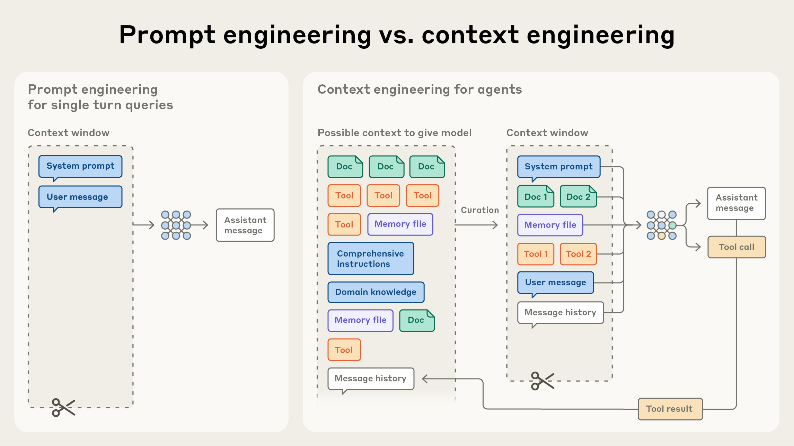
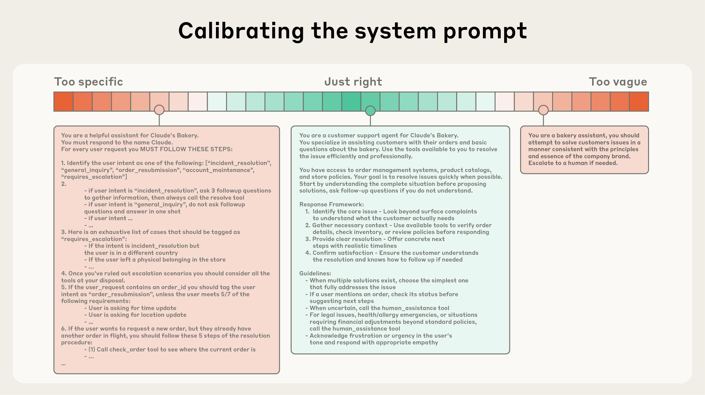

# 面向 AI 智能体的有效上下文工程

> 原文：[Effective context engineering for AI agents](https://www.anthropic.com/research/effective-context-engineering-for-ai-agents)
> 作者：Anthropic　|　发布日期：2025-09-29

在提示词工程（prompt engineering）占据应用 AI 领域焦点几年之后，一个新的术语开始崭露头角：**上下文工程（context engineering）**。基于语言模型构建产品，正在变得越来越不像"为提示词找到恰当的措辞"，而越来越像是回答一个更宏观的问题："什么样的上下文配置，最有可能让模型产生我们期望的行为？"

**上下文** 指的是从大语言模型（LLM）采样时所包含的一组 token。而这里的**工程**问题，在于针对 LLM 的固有约束优化这些 token 的效用，从而稳定地达成预期结果。要真正驾驭 LLM，往往需要*以上下文的方式进行思考*——也就是说：考虑 LLM 在任一时刻可获取的整体状态，以及这种状态可能引发哪些潜在行为。

在这篇文章中，我们将探讨上下文工程这一新兴的艺术，并为构建可控、有效的智能体（agent）提供一个更完善的心智模型。

## 上下文工程 vs. 提示词工程

在 Anthropic，我们将上下文工程视为提示词工程的自然演进。提示词工程指的是为获得最优结果而编写和组织 LLM 指令的方法（可参阅我们的文档，了解提示词工程的概览与实用策略）。而**上下文工程**指的是一整套策略，用于在 LLM 推理过程中策划（curate）并维护最优的 token（信息）集合——包括提示词之外所有可能进入上下文的其他信息。

在用 LLM 做工程实践的早期，提示词是 AI 工程工作中最大的一块，因为在日常聊天之外的大多数用例，都需要为一轮式（one-shot）的分类或文本生成任务优化提示词。顾名思义，提示词工程的核心是如何写出有效的提示词，尤其是系统提示词。然而，随着我们迈向构建能力更强的智能体——它们要在多轮推理和更长的时间跨度上运行——我们就需要管理整个上下文状态的策略（系统指令、工具、模型上下文协议（MCP）、外部数据、消息历史等）。

在循环中运行的智能体会不断生成越来越多的"可能"与下一轮推理相关的数据，这些信息必须被周期性地提炼。上下文工程，就是从那个不断演化的信息宇宙中，策划出进入有限上下文窗口的内容的艺术与科学。

*图 1：与"编写一条提示词"这种离散任务不同，上下文工程是迭代式的——每当我们决定向模型传递什么内容时，都在进行一次策划。*

## 为什么上下文工程对构建强大的智能体至关重要

尽管 LLM 速度极快、能处理的数据量越来越大，我们观察到它们和人类一样，在某个节点之后会失去专注或陷入混乱。针对"大海捞针"式基准测试的研究揭示了一个概念——**上下文腐化（context rot）**：随着上下文窗口中 token 数量的增加，模型从该上下文中准确召回信息的能力会下降。

虽然有些模型的退化曲线比其他模型更平缓，但这一特征在所有模型中都存在。因此，上下文必须被视为一种有限资源，其边际收益是递减的。就像人类的工作记忆容量有限一样，LLM 在解析大量上下文时也有一个"注意力预算"。每一个新引入的 token 都会消耗掉一部分预算，这就更需要精心策划提供给 LLM 的 token。

这种注意力稀缺源于 LLM 的架构约束。LLM 基于 transformer 架构，该架构允许每个 token 与整个上下文中的所有其他 token 相互注意（attend）。这意味着 n 个 token 会产生 n² 个两两关系。

随着上下文长度的增加，模型捕捉这些两两关系的能力会被逐渐稀释，从而在上下文规模与注意力聚焦之间形成一种天然的张力。此外，模型的注意力模式源自训练数据的分布，而在这些分布中，短序列通常远比长序列常见。这意味着模型对跨越整个上下文的依赖关系经验更少，专门用于此的参数也更少。

位置编码插值（position encoding interpolation）等技术让模型能够通过适配原本训练时的较小上下文来处理更长的序列，但对 token 位置的理解会有一定退化。这些因素造成的后果不是一个陡峭的悬崖，而是一条性能梯度：模型在长上下文下依然能力很强，但在信息检索和长程推理上的精度可能不如短上下文下的表现。

这些现实意味着：要想构建强大的智能体，深思熟虑的上下文工程必不可少。

## 有效上下文的解剖

鉴于 LLM 受限于有限的注意力预算，*好的*上下文工程意味着找到**尽可能小**的一组高信号 token，以最大程度提高达成预期结果的可能性。说起来容易做起来难，但在下面的部分中，我们会围绕上下文的不同组成部分，说明这一指导原则在实践中意味着什么。

**系统提示词**应当极为清晰，使用简单、直接的语言，并以*合适的高度*（right altitude）向智能体呈现想法。所谓合适的高度，是介于两种常见失败模式之间的"金发姑娘区"（Goldilocks zone，恰到好处的区间）。一个极端是，工程师在提示词中硬编码复杂而脆弱的逻辑，试图诱导出精确的智能体行为。这种做法会带来脆弱性，并随时间推移增加维护的复杂度。另一个极端是，工程师只提供含糊、高层的指导，无法给 LLM 提供关于期望输出的具体信号，或者错误地假定了模型与你共享同样的背景。最优的高度要在两者之间取得平衡：既足够具体以有效引导行为，又足够灵活，让模型拥有强有力的启发式规则来自主指引行为。

*图 2：频谱的一端是脆弱的 if-else 硬编码提示词，另一端则是过于笼统、或错误假定双方共享背景的提示词。*

我们建议将提示词组织成清晰的分节（比如 `<background_information>`、`<instructions>`、`## Tool guidance`、`## Output description` 等），并使用 XML 标签或 Markdown 标题来划分这些区块——不过随着模型能力增强，提示词的具体格式可能正变得不那么重要。

无论你决定如何组织系统提示词，你都应当追求用最小的信息集合完整勾勒出你期望的行为。（注意，"最小"不一定意味着"短"；你仍需在一开始就给智能体足够的信息，确保其遵循期望的行为。）最好的做法是：先用可用的最强模型测试一个最小化的提示词，看它在你的任务上表现如何，然后根据初期测试中发现的失败模式，添加明确的指令和示例来改进表现。

**工具**让智能体能够与环境交互，并在工作过程中引入新的、额外的上下文。由于工具定义了智能体与其信息/行动空间之间的契约，工具必须促进效率——既要返回 token 高效的信息，也要鼓励高效的智能体行为。

在《用 AI 智能体编写面向 AI 智能体的工具》（Writing tools for AI agents – with AI agents）一文中，我们讨论了如何构建 LLM 能很好理解、且功能重叠最小的工具。就像设计良好的代码库中的函数一样，工具应当是自包含的、对错误健壮的，并且在其预期用途上极为清晰。输入参数同样应当具有描述性、无歧义，并发挥模型的固有优势。

我们最常见到的失败模式之一，是臃肿的工具集：要么覆盖了过多的功能，要么导致"该用哪个工具"的决策点含糊不清。如果一位人类工程师都无法明确说出在某种情况下应该用哪个工具，那就不能指望 AI 智能体做得更好。正如我们后文将讨论的，为智能体策划一个最小可用的工具集，还能让长交互中的上下文维护和修剪更加可靠。

提供示例——也就是所谓的少样本提示（few-shot prompting）——是一个众所周知的最佳实践，我们依然强烈推荐。然而，很多团队会把一大堆边缘案例塞进提示词，试图穷举 LLM 在某个任务上应遵循的所有规则。我们不推荐这样做。相反，我们建议精心挑选一组多样的、典范性的（canonical）示例，有效展现智能体的预期行为。对 LLM 来说，示例就是那种"胜过千言万语"的图画。

我们对上下文各个组成部分（系统提示词、工具、示例、消息历史等）的总体建议是：深思熟虑，让你的上下文既有信息量，又保持紧凑。接下来让我们深入探讨如何在运行时动态检索上下文。

## 上下文检索与智能体式搜索

在《构建有效的 AI 智能体》（Building effective agents）一文中，我们阐明了基于 LLM 的工作流与智能体的区别。自那篇文章之后，我们逐渐收敛到一个简单的智能体定义：**在循环中自主使用工具的 LLM**。

在与客户合作的过程中，我们看到整个行业正在向这个简单的范式收敛。随着底层模型能力的提升，智能体的自主性水平也可以随之扩展：更聪明的模型让智能体能够独立驾驭微妙复杂的问题空间，并从错误中恢复。

我们现在看到工程师在设计智能体上下文的方式上正在发生转变。如今，许多 AI 原生应用采用某种基于嵌入（embedding）的推理前检索，来为智能体呈现重要的推理依据。随着行业向更"智能体化"的方式转型，我们越来越多地看到团队在这种检索系统之上叠加"即时"（just-in-time）上下文策略。

采用"即时"方式的智能体并不预先处理所有相关数据，而是维护轻量的标识符（文件路径、存储的查询、网页链接等），并在运行时通过工具用这些引用动态地把数据加载进上下文。Anthropic 的智能体编程方案 Claude Code 就采用这种方式对大型数据库做复杂的数据分析：模型可以编写有针对性的查询、存储结果，并借助 head、tail 等 Bash 命令分析海量数据，而无需把完整的数据对象载入上下文。这种方式与人类认知很相似：我们通常不会背诵整库的信息，而是建立外部的组织与索引系统——文件系统、收件箱、书签——按需检索相关信息。

除了存储效率之外，这些引用的元数据还提供了一种高效调优行为的机制，无论是显式提供还是直觉性的。对一个在文件系统中工作的智能体来说，`tests` 文件夹下名为 `test_utils.py` 的文件，与位于 `src/core_logic/` 下的同名文件，暗示着完全不同的用途。文件夹层级、命名约定、时间戳，这些都为人类和智能体提供了重要信号，帮助它们理解该如何以及何时使用这些信息。

让智能体自主导航和检索数据，还可以实现**渐进式披露（progressive disclosure）**——换句话说，允许智能体通过探索逐步发现相关上下文。每一次交互产生的上下文都会影响下一个决策：文件大小暗示复杂度；命名约定提示用途；时间戳可以作为相关性的代理指标。智能体可以一层层拼装出理解，只在工作记忆中保留必要的内容，并借助笔记策略实现额外的持久化。这种自我管理的上下文窗口让智能体始终聚焦于相关的子集，而不是淹没在详尽却可能无关的信息中。

当然，这里存在权衡：运行时探索比检索预计算的数据更慢。不仅如此，还需要有主见、有深度的工程设计，才能确保 LLM 拥有合适的工具和启发式规则来高效导航其信息版图。缺乏恰当引导的智能体可能会因误用工具、钻死胡同或抓不住关键信息而浪费上下文。

在某些场景下，最有效的智能体可能采用混合策略：预先检索一部分数据以获得速度，再酌情进行进一步的自主探索。"合适的"自主度边界取决于具体任务。Claude Code 就是采用这种混合模型的智能体：CLAUDE.md 文件会被预先直接放入上下文，而 glob、grep 等原语让它能够在环境中导航、即时检索文件，从而有效绕过索引过期和复杂语法树的问题。

对于内容动态性较低的领域（比如法律或金融工作），混合策略可能更为合适。随着模型能力的提升，智能体设计将趋向于"让聪明的模型聪明地行事"，而人工策划的比重会逐步降低。鉴于该领域快速的进展速度，"做最简单且有效的事"（do the simplest thing that works）仍将是我们给基于 Claude 构建智能体的团队的最佳建议。

### 面向长时程任务的上下文工程

长时程任务要求智能体在一连串动作中保持连贯性、上下文和目标导向行为，而这些动作的 token 总量会超出 LLM 的上下文窗口。对于持续几十分钟到数小时的连续任务——比如大型代码库迁移或综合性研究项目——智能体需要专门的技术来绕过上下文窗口大小的限制。

等待更大的上下文窗口似乎是一个显而易见的策略。但可以预见的是，无论窗口多大，它们都会受到上下文污染和信息相关性问题的制约——至少在追求最强智能体性能的场景下是如此。为了让智能体能在更长的时间跨度上有效工作，我们开发了几种直接应对上下文污染约束的技术：**压缩（compaction）**、**结构化笔记（structured note-taking）**和**多智能体架构（multi-agent architectures）**。

#### 压缩（Compaction）

压缩是指：当一段对话接近上下文窗口上限时，对其内容进行摘要，然后以该摘要重新开启一个新的上下文窗口。压缩通常是上下文工程中撬动更好长期连贯性的第一根杠杆。其核心在于以高保真的方式蒸馏上下文窗口的内容，使智能体能够以最小的性能损失继续工作。

以 Claude Code 为例，我们的实现方式是把消息历史交给模型进行摘要压缩，保留最关键的细节：模型会保留架构决策、未解决的 bug 和实现细节，同时丢弃冗余的工具输出或消息。随后智能体带着这份压缩后的上下文加上最近访问的五个文件继续工作。用户获得了连续性，无需操心上下文窗口的限制。

压缩的艺术在于"保留什么、丢弃什么"的取舍——过于激进的压缩可能丢失那些微妙却关键、其重要性要到后来才显现的上下文。对于实现压缩系统的工程师，我们建议在复杂的智能体轨迹（trace）上仔细调优提示词：先最大化召回率，确保压缩提示词能捕捉轨迹中每一份相关信息；然后再迭代提升精确率，剔除多余内容。

一个最容易下手的多余内容是清理工具调用及其结果——当某次工具调用已经深处消息历史之中，智能体为什么还需要再看到它的原始结果呢？最安全、侵入性最小的一种压缩形式就是工具结果清理（tool result clearing），该功能最近已在 Claude Developer Platform 上推出。

#### 结构化笔记（Structured Note-taking）

结构化笔记，也叫智能体记忆（agentic memory），是指智能体定期将笔记写入并持久化到上下文窗口之外的记忆中，这些笔记会在之后被重新拉回上下文窗口。

这一策略以极小的开销提供了持久记忆。就像 Claude Code 创建待办清单（to-do list），或者你的自定义智能体维护一个 NOTES.md 文件，这个简单的模式让智能体能够跨复杂任务追踪进度，保住那些原本会在几十次工具调用之间丢失的关键上下文和依赖关系。

"Claude 玩宝可梦"（Claude playing Pokémon）展示了记忆如何在编程之外的领域改变智能体的能力。该智能体在数千个游戏步骤中保持精确的计数——追踪这样的目标："在过去的 1234 步里，我一直在 1 号道路练级，皮卡丘已经朝着 10 级的目标升了 8 级。"在没有任何关于记忆结构的提示下，它自己绘制了已探索区域的地图、记住了已解锁的关键成就，并维护了战斗策略笔记，帮助它学习哪种攻击对不同对手最有效。

在上下文重置之后，智能体会读取自己的笔记，继续执行长达数小时的练级序列或地下城探索。这种跨摘要步骤的连贯性，使得长时程策略成为可能——而仅靠把所有信息保留在 LLM 上下文窗口里，是做不到这一点的。

作为 Sonnet 4.5 发布的一部分，我们在 Claude Developer Platform 上公开测试了一个记忆工具（memory tool），它通过基于文件的系统，让在上下文窗口之外存储和查阅信息变得更容易。这使智能体能够随时间积累知识库、跨会话维护项目状态、引用先前的工作，而不必把一切都放在上下文里。

#### 子智能体架构（Sub-agent Architectures）

子智能体架构提供了绕过上下文限制的另一种方式。与其让一个智能体试图在整个项目范围内维护状态，不如让专门的子智能体以干净的上下文窗口去处理聚焦的任务。主智能体以高层计划进行协调，而子智能体执行深度的技术工作，或使用工具查找相关信息。每个子智能体可能进行了大量的探索、消耗数万甚至更多的 token，但最终只返回一份浓缩的、蒸馏过的工作摘要（通常 1000–2000 个 token）。

这种方式实现了清晰的关注点分离——详细的搜索上下文被隔离在子智能体内部，而主智能体专注于综合与分析结果。这一模式（我们在《我们如何构建多智能体研究系统》中讨论过）在复杂研究任务上相比单智能体系统取得了显著提升。

如何在这些方法之间取舍，取决于任务特征。例如：

- **压缩**适合需要大量来回交互的任务，可保持对话的流畅性；
- **笔记**适合有清晰里程碑的迭代式开发；
- **多智能体架构**适合并行探索能带来红利的复杂研究与分析。

即便模型持续进步，如何在长时间交互中保持连贯性，仍将是构建更强大智能体的核心挑战。

## 结论

上下文工程代表着我们构建 LLM 应用方式的根本性转变。随着模型能力越来越强，挑战已不再只是打磨一条完美的提示词，而是深思熟虑地策划：在每一步，什么信息进入模型有限的注意力预算。无论你是在为长时程任务实现压缩、设计 token 高效的工具，还是让智能体即时探索其环境，指导原则始终如一：**找到最小的一组高信号 token，最大程度提高达成预期结果的可能性。**

随着模型的改进，我们概述的这些技术也会持续演进。我们已经看到，更聪明的模型需要的工程指导越来越少，从而允许智能体以更高的自主性运行。但即便能力不断扩展，把上下文当作珍贵而有限的资源来对待，仍将是构建可靠、有效智能体的核心。

今天就到 Claude Developer Platform 上开始你的上下文工程实践吧，并通过我们的记忆与上下文管理 cookbook 获取实用的技巧和最佳实践。

## 作者与致谢

本文由 Anthropic 应用 AI 团队（Applied AI team）撰写，作者：Prithvi Rajasekaran、Ethan Dixon、Carly Ryan、Jeremy Hadfield；团队其他成员 Rafi Ayub、Hannah Moran、Cal Rueb、Connor Jennings 亦有贡献。特别感谢 Molly Vorwerck、Stuart Ritchie 和 Maggie Vo 的支持。
