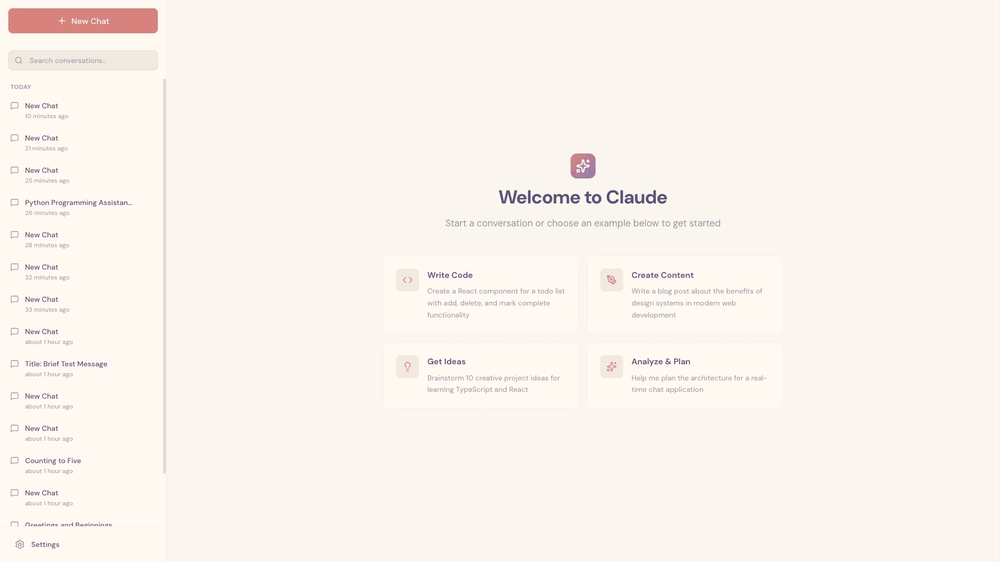

# 面向长时间运行智能体的高效运行框架

随着 AI 智能体（agent）的能力不断增强，开发者开始让它们承担耗时数小时甚至数天的复杂任务。然而，如何让智能体跨多个上下文窗口持续、稳步地推进任务，仍是一个尚未解决的问题。

长时间运行的智能体面临一个核心挑战：工作必须分散在多个独立会话中完成，而每次新会话开始时，智能体都不记得此前发生过什么。这就像让工程师轮班开发一个软件项目，但每位接班的工程师都不知道上一班做了什么。上下文窗口容量有限，大多数复杂项目又无法在单个窗口内完成，因此，智能体需要一套衔接机制，弥合编码会话之间的信息断层。

我们设计了一套分工协作的方案，让 [Claude Agent SDK](https://platform.claude.com/docs/en/agent-sdk/overview) 能够跨多个上下文窗口高效工作：由**初始化智能体（initializer agent）**在首次运行时搭建环境，再由**编码智能体（coding agent）**在每个会话中逐步推进任务，并留下清晰的工作产物（artifacts），供下一个会话接续工作。配套的[快速入门示例（quickstart）](https://github.com/anthropics/claude-quickstarts/tree/main/autonomous-coding)提供了示例代码。

## 长时间运行的智能体面临的问题

Claude Agent SDK 是一个功能强大的通用智能体运行框架（harness），既适合编码，也适合其他需要模型借助工具收集上下文、制定计划并执行的任务。它提供压缩（compaction）等上下文管理能力，让智能体不必耗尽上下文窗口就能持续处理任务。理论上，有了这些能力，智能体应该可以无限期地持续完成有价值的工作。

然而，仅靠压缩还不够。即便是 Opus 4.5 这样的前沿编码模型，如果只给它一个概括性的 prompt，例如“做一个 [claude.ai](http://claude.ai) 的克隆版”，让它在 Claude Agent SDK 的默认配置下跨多个上下文窗口循环运行，也无法构建出达到生产级质量的 Web 应用。

Claude 的失败主要有两种模式。第一种是智能体试图一次完成太多工作，本质上是想一次性（one-shot）构建整个应用。这往往导致模型在实现功能的中途耗尽上下文，留给下一个会话的只有半成品，而且没有文档说明。接手的智能体只能猜测此前的工作情况，再花大量时间恢复应用的基本功能。即使启用了压缩，这种情况仍会发生，因为压缩不一定能向下一个智能体传递足够清晰的指令。

第二种失败模式往往出现在项目后期：应用刚实现一部分功能，接手的智能体实例看到已有成果，就宣布整个项目大功告成。

因此，我们需要从两方面着手。首先，搭建初始环境，为实现给定 prompt 要求的*全部*功能打好基础，让智能体能够逐步推进，一次完成一个功能。其次，通过指令引导每个智能体朝目标逐步推进，并在会话结束时让环境保持干净。所谓“干净”，是指代码已达到可以合并到主分支的状态：没有重大缺陷（bug），代码整洁，文档完善。这样，开发者就能直接着手开发新功能，而不必先收拾与当前任务无关的烂摊子。

在内部实验中，我们通过以下两部分方案解决了这些问题：

1. **初始化智能体**：首个会话使用专门的 prompt，要求模型搭建初始环境，包括 `init.sh` 脚本、记录智能体工作日志的 claude-progress.txt 文件，以及保存应用可用状态的首次 git 提交。
2. **编码智能体**：后续每个会话都要求模型逐步推进任务，并留下结构化的进度更新。[^1]

关键在于结合 claude-progress.txt 文件与 git 历史，让智能体即使从全新的上下文窗口启动，也能迅速了解当前工作状态。这些做法的灵感，来自我们对高效软件工程师日常工作方式的观察。

## 环境管理

在更新后的 [Claude 4 提示词指南](https://docs.claude.com/en/docs/build-with-claude/prompt-engineering/claude-4-best-practices#multi-context-window-workflows)中，我们分享了多上下文窗口工作流的一些最佳实践，其中一种运行框架设计是为首个上下文窗口使用单独的 prompt。这个 prompt 要求初始化智能体在环境中准备好全部必要上下文，供后续编码智能体高效工作。下文将详细介绍这类环境的几个关键组成部分。

### 功能清单

为避免智能体试图一次性构建整个应用，或过早认定项目已经完成，我们要求初始化智能体将用户的初始 prompt 展开为一份完整的功能需求文件。以 [claude.ai](http://claude.ai) 克隆版为例，这份文件列出了 200 多项功能，例如“用户可以发起新聊天、输入问题、按下回车键，并看到 AI 的回复”。所有功能起初都标记为“未通过”（failing），让后续编码智能体清楚地了解全部待实现功能。

```json
{
    "category": "functional",
    "description": "New chat button creates a fresh conversation",
    "steps": [
      "Navigate to main interface",
      "Click the 'New Chat' button",
      "Verify a new conversation is created",
      "Check that chat area shows welcome state",
      "Verify conversation appears in sidebar"
    ],
    "passes": false
  }
```

我们要求编码智能体只修改该文件中 passes 字段的值，并用措辞强硬的指令强调约束，例如“不得删除或修改测试，否则可能导致功能缺失或引入 bug”。经过多次实验，我们最终选择用 JSON 保存功能清单，因为相比 Markdown 文件，模型更少出现不当修改或覆盖 JSON 文件的情况。

### 增量推进

初始环境就绪后，我们要求后续编码智能体在每轮迭代中只实现一个功能。事实证明，这种增量推进方式至关重要，能有效遏制智能体一次承担过多工作的倾向。

采用增量推进方式后，模型仍必须在每次修改代码后保持环境干净。实验表明，最有效的引导方式是要求模型将工作成果提交到 git，写清提交说明，并在进度文件中记录摘要。这样，模型就能通过 git 回滚有问题的改动，让代码库恢复到可用状态。

这些做法也提高了效率：智能体不必再猜测此前做过什么，也不必花时间恢复应用的基本功能。

### 测试

我们观察到的最后一种主要失败模式是：Claude 往往尚未充分测试，就将功能标记为完成。如果没有明确指令，Claude 通常只会修改代码，有时也会运行单元测试，或用 `curl` 命令向开发服务器发送请求来测试，却没有意识到该功能还无法端到端（end-to-end）正常运行。

构建 Web 应用时，只要明确要求 Claude 使用浏览器自动化工具，像真实用户一样完成所有测试，它通常就能较好地验证各项功能是否端到端可用。



*Claude 测试 claude.ai 克隆版时通过 Puppeteer MCP 服务器截取的画面。*

这类测试工具显著改善了 Claude 的表现，让智能体能够发现并修复仅靠阅读代码难以察觉的 bug。

不过，问题并未完全解决。受限于 Claude 的视觉能力和浏览器自动化工具，智能体仍难以识别所有类型的 bug。例如，Claude 无法通过 Puppeteer MCP 看到浏览器原生警告弹窗，因此，依赖这类弹窗的功能往往存在更多 bug。

## 进入状态

在上述安排基础上，我们要求每个编码智能体先执行一系列步骤，了解当前工作状态。其中有些步骤很基础，但依然有用：

1. *运行 `pwd`，确认当前工作目录。只能编辑该目录中的文件。*
2. *阅读 git 日志和进度文件，了解最近完成了哪些工作。*
3. *阅读功能清单文件，从尚未完成的功能中选择优先级最高的一项，着手实现。*

这种做法能在每个会话中节省一些 token，因为 Claude 不必再自行摸索如何测试代码。让初始化智能体编写用于启动开发服务器的 init.sh 脚本也很有帮助，方便后续智能体在实现新功能前先运行一遍基本的端到端测试。

以 claude.ai 克隆版为例，智能体每次都会先启动本地开发服务器，再用 Puppeteer MCP 发起新聊天、发送消息并接收回复。这样，Claude 就能迅速发现上一轮会话是否留下了无法正常运行的应用，并立即修复已有 bug。如果跳过检查，直接开发新功能，反而很可能让问题进一步恶化。

综合这些做法，一个典型会话会以下列助手消息开场：

```text
[Assistant] I'll start by getting my bearings and understanding the current state of the project.
[Tool Use] <bash - pwd>
[Tool Use] <read - claude-progress.txt>
[Tool Use] <read - feature_list.json>
[Assistant] Let me check the git log to see recent work.
[Tool Use] <bash - git log --oneline -20>
[Assistant] Now let me check if there's an init.sh script to restart the servers.
<Starts the development server>
[Assistant] Excellent! Now let me navigate to the application and verify that some fundamental features are still working.
<Tests basic functionality>
[Assistant] Based on my verification testing, I can see that the fundamental functionality is working well. The core chat features, theme switching, conversation loading, and error handling are all functioning correctly. Now let me review the tests.json file more comprehensively to understand what needs to be implemented next.
<Starts work on a new feature>
```

## 智能体失败模式与解决方案

| 问题 | 初始化智能体的行为 | 编码智能体的行为 |
|---|---|---|
| Claude 过早宣告整个项目完成。 | 根据输入的需求规格创建结构化的 JSON 功能清单文件，逐项描述功能的端到端行为。 | 在会话开始时阅读功能清单文件，选择一项功能着手实现。 |
| Claude 留下有 bug 的环境，或未记录工作进度。 | 初始化 git 仓库，创建进度记录文件。 | 会话开始时阅读进度文件和 git 提交日志，并在开发服务器上运行基本测试，发现尚未记录的 bug。会话结束时提交 git 变更并更新进度文件。 |
| Claude 过早将功能标记为完成。 | 创建功能清单文件。 | 自行验证全部功能，充分测试后才将其标记为“通过”。 |
| Claude 需要花时间摸索如何运行应用。 | 编写用于启动开发服务器的 `init.sh` 脚本。 | 在会话开始时阅读 `init.sh`。 |

*长时间运行的 AI 智能体常见的四种失败模式及相应解决方案。*

## 未来工作

这项研究展示了如何在智能体运行框架中组合一套可行的机制，支持模型长时间运行，跨多个上下文窗口逐步推进任务。不过，仍有一些问题尚待解答。

其中最值得关注的是：单个通用编码智能体是否在所有场景下都是最优选择，还是多智能体架构能带来更好的表现？目前尚无定论。一个合理的推测是，测试、质量保障或代码清理等专用智能体，或许更擅长处理软件开发生命周期中各自对应的子任务。

此外，这个演示专门针对全栈 Web 应用开发做了优化。未来可以探索如何将这些发现推广到其他领域。其中部分乃至全部经验，很可能也适用于科学研究、金融建模等其他需要智能体长时间运行的任务。

## 脚注

[^1]: 这里将二者称为不同的智能体，只是因为它们使用的初始用户 prompt 不同；系统提示词、工具集以及整体智能体运行框架完全相同。

## 作者与致谢

### 致谢

本文由 Justin Young 撰写。特别感谢 David Hershey、Prithvi Rajasakeran、Jeremy Hadfield、Naia Bouscal、Michael Tingley、Jesse Mu、Jake Eaton、Marius Buleandara、Maggie Vo、Pedram Navid、Nadine Yasser 和 Alex Notov 的贡献。

这项工作凝聚了 Anthropic 多个团队的心血，尤其是 code RL 和 Claude Code 团队。得益于他们的努力，Claude 才能安全地承担长时程（long-horizon）自主软件工程任务。如果你也有兴趣参与这项工作，欢迎前往 [anthropic.com/careers](http://anthropic.com/careers) 申请加入。
